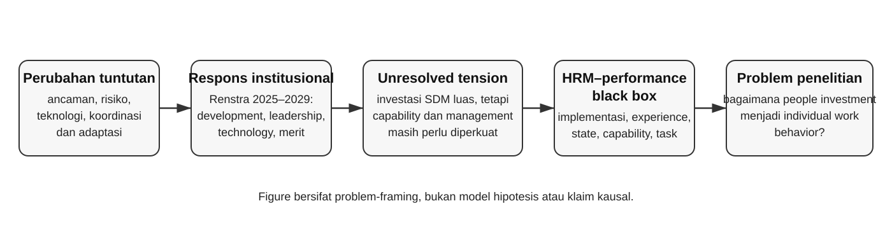
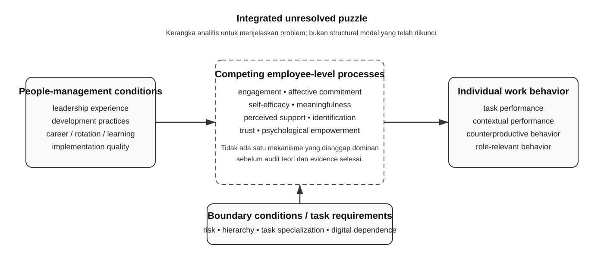

# 1.1 Latar Belakang

> **Status naskah:** draft substantif tingkat disertasi yang disusun sebagai *problem-driven argument*, bukan sebagai justifikasi urutan variabel dalam model. Renstra Korbrimob Polri 2025–2029, KEP/299/V/2025 tanggal 23 Mei 2025, digunakan sebagai *primary institutional guideline* untuk menetapkan konteks, problem, tuntutan strategis, dan arah pengembangan organisasi; bukan sebagai bukti kausal pada level personel. Konstruk, mekanisme, batas populasi, dan posisi kompetensi digital belum dianggap final sebelum Issues #9–#12 selesai dan diverifikasi peneliti. Tabel dan figure pada bagian ini berfungsi sebagai alat sintesis argumentasi; tidak ada statistik, persentase, atau distribusi empiris yang ditambahkan tanpa sumber.

Perubahan lingkungan strategis keamanan pada periode 2025–2029 meningkatkan kompleksitas tuntutan terhadap organisasi kepolisian. Gangguan keamanan berintensitas tinggi tidak lagi dapat dihadapi hanya melalui kesiapan fisik, jumlah personel, kepatuhan prosedural, atau ketepatan pengerahan kekuatan. Pelaksanaan tugas semakin menuntut kemampuan memperoleh dan memproses informasi secara cepat, berkoordinasi lintas fungsi, menggunakan teknologi komunikasi dan perangkat khusus, menyesuaikan diri dengan modus ancaman yang berubah, serta mengambil keputusan dalam situasi yang memiliki konsekuensi operasional tinggi. Perubahan tersebut menjadikan kualitas sumber daya manusia sebagai bagian dari kapasitas operasional organisasi, bukan sekadar fungsi administratif yang berada di luar proses inti. Bagi organisasi yang mengandalkan kesiapan personel sebagai instrumen utama pelaksanaan tugas, perubahan sifat pekerjaan pada akhirnya juga mengubah standar mengenai kompetensi, kepemimpinan, pembelajaran, dan perilaku kerja yang dibutuhkan.

Kondisi tersebut mempunyai arti khusus bagi Korps Brigade Mobil Kepolisian Negara Republik Indonesia (Korbrimob Polri). Korbrimob bekerja dalam struktur yang hierarkis, berbasis komando, berorientasi misi, memiliki konsekuensi keselamatan yang tinggi, dan mengandalkan kemampuan khusus yang harus dipelihara melalui latihan berkelanjutan. Karakter ini membedakannya dari banyak konteks organisasi sipil tempat sebagian besar teori dan temuan Manajemen Sumber Daya Manusia (MSDM) dikembangkan. Dalam organisasi seperti Korbrimob, disiplin, standardisasi, kepatuhan pada rantai komando, dan penguasaan prosedur merupakan kebutuhan dasar; pada saat yang sama, perubahan ancaman dan teknologi menuntut pembelajaran, adaptasi, pemecahan masalah, koordinasi, dan penggunaan diskresi profesional. Dengan demikian, terdapat ketegangan inheren antara kebutuhan menjaga konsistensi melalui struktur formal dan kebutuhan menghasilkan perilaku adaptif melalui kualitas manusia. Ketegangan inilah yang membuat Korbrimob relevan secara teoretis bagi kajian MSDM, bukan semata-mata karena institusi tersebut berbeda dari perusahaan atau organisasi publik lainnya.

Kompleksitas konteks Korbrimob juga tampak pada heterogenitas fungsi dan tuntutan tugas. Namun, heterogenitas tersebut tidak boleh dibaca seolah-olah penelitian ini telah memiliki distribusi empiris mengenai intensitas setiap tuntutan kerja. Tabel 1 karena itu hanya menyajikan pengelompokan analitis awal berdasarkan fungsi yang disebut dalam konteks institusional dan kebutuhan kerja yang secara logis berbeda; pengelompokan ini masih harus diuji terhadap kondisi lapangan pada Issue #9.

**Tabel 1. Pengelompokan analitis heterogenitas tugas Korbrimob dan implikasi MSDM**

| Kelompok fungsi/tugas | Contoh fungsi yang relevan | Tuntutan kerja yang secara konseptual menonjol | Relevansi teknologi/digital | Implikasi bagi penelitian MSDM |
|---|---|---|---|---|
| Taktis dan respons berintensitas tinggi | Pelopor, Wanteror | kesiapan fisik, koordinasi tim, ketepatan prosedur, keputusan di bawah tekanan | dapat penting melalui komunikasi, situational awareness, dan perangkat pendukung, tetapi tidak diasumsikan dominan | performance perlu dibaca dalam konteks kerja kolektif dan high-risk |
| Spesialis teknis | Jibom, KBRN, fungsi kemampuan khusus | presisi teknis, standardisasi, penguasaan alat/prosedur khusus, pembelajaran berkelanjutan | berpotensi tinggi karena penggunaan perangkat dan informasi teknis | competence development dan task-specific capability menjadi penting |
| Informasi dan dukungan intelijen | Intelijen, fungsi informasi | pengumpulan, pengolahan, interpretasi, dan komunikasi informasi | relatif kuat secara konseptual | digital competence tidak boleh disamakan dengan digital transformation organisasi |
| Pendidikan dan pengembangan kemampuan | Satuan Latihan, tenaga pendidik/instruktur | transfer pengetahuan, relevansi kurikulum, asesmen, pembinaan kemampuan | tergantung konten pembelajaran dan media yang digunakan | kualitas implementasi HRD dapat berbeda dari sekadar keberadaan program |
| Teknologi dan dukungan sistem | fungsi TIK dan bantuan teknis | reliabilitas sistem, dukungan operasional, penguasaan perangkat | tinggi secara langsung | heterogenitas digital task requirements harus dipertimbangkan |
| Fungsi pendukung lainnya | administrasi dan fungsi pendukung | ketepatan proses, koordinasi, pelayanan internal | bervariasi | populasi tidak boleh diperlakukan homogen tanpa verifikasi |

*Catatan: tabel merupakan pengelompokan analitis, bukan data distribusi personel, tingkat kompetensi, atau intensitas teknologi. Validasi field-level masih diperlukan.*

Arah penguatan SDM tersebut tercermin secara formal dalam *Rencana Strategis Korps Brimob Polri Tahun 2025–2029* yang ditetapkan melalui KEP/299/V/2025 tanggal 23 Mei 2025. Renstra menempatkan pengembangan dan pengelolaan SDM, profesionalisme, peningkatan kemampuan, penguasaan ilmu pengetahuan dan teknologi, serta modernisasi sebagai bagian penting dari agenda strategis organisasi (Korbrimob Polri, 2025). Di dalamnya terdapat berbagai program dan arah pengembangan seperti pemeliharaan dan peningkatan kemampuan fungsi Brimob melalui *Latharkatpuan*, peningkatan kualitas dan relevansi kurikulum serta bahan ajar, peningkatan sertifikasi kompetensi, penguatan kompetensi instruktur, pengembangan karier, rotasi, penerapan *merit system*, *personalized learning*, *reward and punishment* berbasis kinerja, serta peningkatan kapabilitas yang berkaitan dengan teknologi dan *data analytics*.

Renstra yang sama juga memuat diagnosis mengenai area yang masih perlu diperkuat. Dokumen tersebut mencatat kelemahan pada aspek kepemimpinan dalam pembinaan, operasional, pengendalian, dan pengawasan; profesionalisme tenaga pendidik atau instruktur yang belum memadai; kebutuhan modernisasi kemampuan SDM, termasuk penguasaan teknologi komunikasi; kebutuhan peningkatan kualitas dan kuantitas SDM serta penguasaan ilmu pengetahuan dan teknologi; dan kebutuhan peningkatan efektivitas serta efisiensi operasional. Agar fungsi Renstra dalam argumentasi tidak tenggelam dalam uraian naratif, Tabel 2 memetakan hubungan antara diagnosis institusional, respons strategis, dan makna MSDM yang secara sah dapat diturunkan darinya.

**Tabel 2. Peta evidence institusional Renstra dan makna problem MSDM**

| Area institusional | Evidence/arah Renstra 2025–2029 | Apa yang dapat disimpulkan | Apa yang tidak boleh disimpulkan |
|---|---|---|---|
| Kepemimpinan | kebutuhan penguatan kepemimpinan dalam pembinaan, operasional, pengendalian, dan pengawasan | leadership merupakan domain organisasi yang relevan untuk diteliti | bahwa seluruh pimpinan berkualitas rendah atau problem tersebut identik dengan rendahnya transformational leadership |
| Pendidikan dan instruktur | profesionalisme instruktur belum memadai; peningkatan kualitas kurikulum/bahan ajar dan kompetensi instruktur | kualitas implementasi pengembangan kemampuan menjadi isu institusional | bahwa jumlah pelatihan yang tinggi pasti meningkatkan performance individu |
| Pengembangan kemampuan | Latharkatpuan, sertifikasi, pengembangan karier, rotasi, personalized learning | organisasi telah memiliki investasi people development yang luas | bahwa keberadaan program sama dengan efektivitas program atau actual competence |
| Sistem SDM | merit system, reward and punishment berbasis kinerja, rotasi sesuai kebutuhan | pengelolaan SDM diarahkan pada diferensiasi berbasis kebutuhan dan kinerja | bahwa seluruh personel mengalami sistem tersebut secara identik |
| Teknologi dan Iptek | kebutuhan penguasaan teknologi komunikasi, teknologi, data analytics, modernisasi peralatan | teknologi mengubah tuntutan capability organisasi | bahwa semua pekerjaan memiliki digital task requirements yang sama atau digital competence otomatis menjadi moderator |
| Kualitas SDM dan efektivitas | kebutuhan peningkatan kualitas/kuantitas SDM dan efektivitas operasional | terdapat agenda capability strengthening yang berkelanjutan | bahwa kinerja individual personel secara umum rendah |

Sumber institusional tersebut menghasilkan sebuah *tension* yang penting. Korbrimob bukan organisasi yang tidak melakukan investasi pada manusia; sebaliknya, organisasi telah memiliki latihan, sertifikasi, pengembangan karier, pembinaan kepemimpinan, sistem merit, rotasi, dan modernisasi kemampuan. Namun, dokumen strategis yang sama masih menempatkan sejumlah capability dan management domains sebagai area yang perlu diperkuat. Koeksistensi ini tidak membuktikan bahwa program yang ada gagal. Standar dapat meningkat, lingkungan tugas dapat berubah, teknologi dapat menghadirkan kebutuhan baru, dan kualitas implementasi dapat berbeda antarunit maupun kelompok personel. Akan tetapi, kondisi tersebut membuka pertanyaan yang lebih substantif: melalui proses apa investasi organisasi terhadap manusia benar-benar menjadi kualitas perilaku kerja pada level personel?

Figure 1 merangkum alur argumentasi tersebut. Figure ini tidak memuat hubungan kausal antarvariabel dan tidak dimaksudkan sebagai structural model. Fungsinya adalah menunjukkan bagaimana problem penelitian muncul dari hubungan antara perubahan tuntutan kerja, respons institusional, dan ketidakpastian mengenai proses konversi people investment menjadi work behavior.

**Figure 1. Alur problem framing dari perubahan tuntutan kerja menuju HRM–performance black box.**

Diagnosis institusional tersebut tetap perlu ditafsirkan secara hati-hati. Renstra bukan instrumen untuk mengukur persepsi kepemimpinan setiap personel, tingkat komitmen psikologis, kompetensi digital individu, atau kinerja individual. Dokumen perencanaan strategis juga tidak dapat digunakan untuk menyimpulkan bahwa seluruh pimpinan memiliki kualitas rendah, seluruh personel belum kompeten, atau Korbrimob secara umum berkinerja buruk. Dokumen yang sama mencatat kekuatan organisasi dan berbagai capaian, sehingga narasi “krisis kinerja” tidak memiliki dasar yang memadai. Fenomena yang lebih defensible bukan rendahnya kinerja Korbrimob, melainkan kebutuhan untuk memahami proses melalui mana investasi organisasi terhadap manusia diterjemahkan ke dalam kualitas perilaku kerja pada level personel.

Pertanyaan tersebut berhubungan dengan perdebatan *HRM–performance black box*. Literatur strategic HRM menunjukkan bahwa keberadaan kebijakan atau praktik SDM tidak secara otomatis menghasilkan outcome yang sama pada setiap pegawai. Di antara praktik yang dirancang organisasi dan perilaku kerja individual terdapat proses implementasi, pengalaman pegawai, persepsi terhadap dukungan, kualitas pembelajaran, kesempatan menggunakan kemampuan, relasi dengan atasan, motivasi, sikap, dan kondisi tugas. Review mutakhir terhadap perkembangan strategic HRM mempertahankan mekanisme mediasi, heterogenitas implementasi, perbedaan level analisis, dan kondisi batas sebagai persoalan penting dalam menjelaskan variasi hubungan antara praktik HRM dan performance (Zhai, Zhu, & Zhang, 2026). Pembedaan antara praktik yang dimaksudkan organisasi dan pengalaman aktual pegawai juga semakin penting karena persepsi terhadap praktik dapat berbeda menurut individu, line management, fungsi HR, dan konteks organisasi (van Beurden et al., 2026). Dengan kata lain, *having HR practices* tidak identik dengan *realizing employee performance*.

Karena itu, perpindahan dari Renstra menuju penelitian individual harus dilakukan secara eksplisit. Renstra, SAKIP/LKIP, capaian program, keberhasilan operasi, dan indikator kinerja satuan merupakan data yang sah pada level masing-masing, tetapi tidak dapat diperlakukan sebagai pengukuran langsung terhadap kinerja seorang personel. Tabel 3 menunjukkan batas level analisis yang perlu dijaga agar argumentasi tidak melakukan *ecological fallacy*.

**Tabel 3. Disiplin level analisis dalam problem penelitian**

| Level | Contoh evidence/indikator | Apa yang dapat dijelaskan | Risiko inferensi jika dicampurkan |
|---|---|---|---|
| Organisasi | Renstra, sasaran strategis, kebijakan SDM, modernisasi, program pengembangan | prioritas, diagnosis, investasi, arah organisasi | menganggap diagnosis organisasi sebagai kondisi psikologis setiap personel |
| Unit/satuan | capaian operasi, kesiapan unit, koordinasi, output program | kinerja dan kondisi kolektif/unit | menganggap outcome unit identik dengan individual work performance |
| Individu | persepsi terhadap leadership/praktik pengembangan, employee states, competence, work behavior | pengalaman, capability, sikap, dan perilaku personel | menggeneralisasi hasil individu langsung menjadi efektivitas organisasi |

Dalam konteks ini, *individual work performance* lebih relevan daripada menggunakan capaian organisasi sebagai proksi. Literatur kinerja individual umumnya memandang performance sebagai konstruk multidimensional yang meliputi *task performance*, *contextual performance*, dan *counterproductive work behavior*. Widyastuti et al. (2024) memberikan bukti bahwa versi Indonesia dari *Individual Work Performance Questionnaire* mempertahankan struktur tiga faktor pada sampel pekerja Indonesia. Namun, validasi umum tersebut belum menjamin bahwa seluruh dimensi yang penting pada pekerjaan berisiko tinggi, berbasis tim, dan berorientasi keselamatan telah sepenuhnya terwakili. Karena itu, individual work performance memiliki kecocokan level analisis yang lebih baik, tetapi kesesuaian instrumen tetap harus diuji pada konteks Korbrimob.

Setelah perbedaan level analisis diperjelas, persoalan berikutnya adalah bagaimana sistem formal sampai pada pengalaman individual. Dalam organisasi hierarkis, salah satu saluran terpenting adalah pimpinan. Atasan menerjemahkan kebijakan menjadi prioritas kerja, menentukan ekspektasi, memberikan umpan balik, mengalokasikan kesempatan, membentuk interpretasi terhadap perubahan, dan dalam banyak situasi memfasilitasi atau menghambat proses belajar. Karena itu, diagnosis Renstra mengenai kepemimpinan mempunyai makna lebih luas daripada kebutuhan memperbaiki gaya memimpin: ia menunjuk pada posisi leadership sebagai bagian dari proses implementasi organisasi.

Meski demikian, kata “kepemimpinan” dalam Renstra tidak dapat langsung dipadankan dengan satu konstruk akademik tertentu. Literatur juga tidak menunjukkan bahwa satu gaya secara universal unggul untuk seluruh outcome. Fuller, Bajaba, dan Bajaba (2022) memperlihatkan overlap yang substansial di antara berbagai bentuk *newer genre leadership*. Filstad, Karp, dan Rød (2024) mengkritik kecenderungan studi police leadership yang terlalu leader-centric dan kurang memperhatikan sifat relasional, struktural, situasional, dan hierarkis. Evidence extreme context juga menunjukkan bahwa kondisi risiko dapat mengubah hubungan antara leadership dan outcomes (Lester, Harms, & DeSimone, 2022). Transformational leadership karena itu relevan sebagai kandidat yang menekankan vision, change, intellectual stimulation, dan individual development, tetapi tidak boleh diasumsikan sebagai representasi tunggal dari problem kepemimpinan organisasi.

Literatur empiris bahkan menunjukkan pluralitas mechanism. Park et al. menempatkan employee engagement sebagai mediator penting dalam hubungan transformational leadership dengan affective organizational commitment dan job performance; Jiatong et al. (2022) kembali menunjukkan engagement sebagai mekanisme penting; Sürücü, Maşlakçı, dan Şeşen (2022) menonjolkan self-efficacy dan leader support; Bader, Gielnik, dan Bledow (2022) menempatkan kebutuhan psikologis, positive affect, dan engagement; sedangkan Meng et al. (2022) pada polisi lokal menunjukkan peran meaningfulness. Sudha, Azam, dan Tham (2023) bahkan tidak menemukan hubungan langsung yang signifikan antara transformational leadership dan job performance pada konteks mereka, dengan organizational commitment berperan sebagai mediator berukuran efek kecil. Pola tersebut tidak membatalkan transformational leadership, tetapi menunjukkan bahwa hubungan leadership–performance tidak dapat diperlakukan sebagai jalur langsung yang universal.

Saluran kedua yang sangat dekat dengan Renstra adalah pengembangan kompetensi. Latihan, kurikulum, sertifikasi, peningkatan instruktur, rotasi, pengembangan karier, dan *personalized learning* menunjukkan bahwa organisasi menggunakan berbagai mekanisme untuk memelihara dan memperluas kemampuan personel. Namun, *competence development practices* harus dibedakan dari competence aktual. Praktik pengembangan merupakan input dan kesempatan organisasi; competence merupakan capability yang berhasil dibangun dan dapat digunakan individu. Moreira, Tomás, dan Antunes (2024) menunjukkan bahwa competence-development practices berupa training, individualized support, dan functional rotation berkaitan dengan affective commitment dan turnover intentions, dengan pola yang berbeda antar generasi. Pada konteks kepolisian Indonesia, Wanto dan Kusumatuti (2023) menunjukkan pola hubungan antara training, competence, affective commitment, dan performance yang tidak seluruhnya langsung. Keduanya memperkuat argumen bahwa keberadaan development dan capability tidak identik dengan performance, tetapi keterbatasan desain dan perbedaan outcome mencegah klaim kausal yang terlalu kuat.

Masalah tersebut merupakan persoalan transfer. Organisasi dapat menyediakan program, tetapi nilai program baru tercipta ketika pengetahuan, keterampilan, atau pengalaman yang diperoleh dapat digunakan dalam pekerjaan. Transfer bergantung pada relevansi tugas, kualitas materi dan instruktur, kesempatan aplikasi, feedback, dukungan atasan, serta kondisi kerja. Selain membentuk capability, investasi organisasi juga dapat membentuk employee states: merasa didukung, lebih yakin terhadap kemampuan diri, lebih engaged, lebih teridentifikasi dengan organisasi, lebih percaya pada pimpinan, atau lebih terikat secara afektif. Karena berbagai state tersebut saling berdekatan secara konseptual dan empiris, AOC tidak boleh dipilih hanya karena populer atau karena sering berkorelasi dengan performance.

Tabel 4 merangkum beberapa studi yang paling dekat dengan problem penelitian. Tabel ini sengaja menempatkan mekanisme, outcome, konteks, dan limitasi secara berdampingan agar literature review berfungsi sebagai sintesis, bukan daftar artikel.

**Tabel 4. Sintesis empirical literature terdekat terhadap problem penelitian**

| Studi | Fokus utama | Mekanisme/temuan penting | Outcome/konteks | Batas inferensi untuk penelitian ini |
|---|---|---|---|---|
| Park et al. (2021/2022) | transformational leadership, AOC, engagement, job performance | engagement memediasi TL→AOC dan TL→performance; bukan AOC sebagai mediator TL→performance | 600 pekerja swasta Korea | konteks sipil; mendukung rival mechanism engagement |
| Jiatong et al. (2022) | TL, AOC, engagement, performance | engagement menjadi mekanisme penting | 845 pekerja hotel China | hospitality; tidak menetapkan AOC sebagai satu-satunya mekanisme |
| Sürücü et al. (2022) | TL dan performance | self-efficacy sebagai mediator; leader support sebagai kondisi | konteks organisasi umum | menunjukkan mechanism dan boundary condition alternatif |
| Meng et al. (2022) | TL dan work engagement | meaningfulness berperan dalam hubungan | 261 polisi lokal, 32 kantor | outcome bukan IWP; tetapi relevan untuk konteks police leadership |
| Moreira et al. (2024) | competence-development practices | AOC memediasi hubungan dengan turnover intentions; heterogenitas generasi | 2.123 pekerja Portugal | outcome turnover, bukan performance |
| Wanto & Kusumatuti (2023) | training, competence, AOC, performance | competence tidak langsung signifikan; AOC berperan pada beberapa jalur | 206 personel kepolisian Indonesia | cross-sectional; konstruk development berbeda |
| Ochoa Pacheco & Coello-Montecel (2023) | digital competence dan performance | psychological empowerment menjadi bagian dari mekanisme | profesional | mendukung digital competence sebagai resource, bukan otomatis moderator |
| Widyastuti et al. (2024) | validasi IWPQ Indonesia | struktur task/contextual/CWB didukung | 609 pekerja Indonesia | belum menjamin equivalence pada high-risk police roles |
| Filstad, Karp, & Rød (2024) | review police leadership | perlunya contextualized, relational, structural view | review literatur kepolisian | memperingatkan transfer langsung model leadership sipil |
| Woznyj et al. (2022) | meta-analytic review job attitudes | job attitudes saling berkorelasi dan memiliki nomological overlap | meta-analytic evidence | menantang pemilihan mediator hanya berdasarkan korelasi |

Literatur tersebut menunjukkan bahwa employee-level mechanism bersifat plural. Affective organizational commitment tetap relevan karena menekankan keterikatan emosional, identifikasi, dan keinginan menjadi bagian organisasi, tetapi Renstra tidak mendokumentasikan defisit AOC. Jiwa korsa, loyalitas, disiplin, atau dedikasi juga tidak dapat diperlakukan sebagai proxy langsung AOC. Pertanyaan yang lebih valid adalah apakah emotional attachment memberikan explanatory value yang cukup dibandingkan engagement, perceived organizational support, organizational identification, trust, meaningfulness, self-efficacy, atau psychological empowerment.

**Tabel 5. Rival employee-state mechanisms dalam HRM–performance black box**

| Mekanisme | Inti penjelasan | Mengapa plausible | Mengapa belum otomatis dipilih |
|---|---|---|---|
| Affective organizational commitment | emotional attachment dan willingness to remain/contribute | organisasi berbasis misi dan identitas dapat membuat attachment relevan | locus evidence tidak menunjukkan defisit AOC; overlap dengan sikap lain perlu diuji |
| Work engagement | energi, dedikasi, keterlibatan dalam pekerjaan | muncul konsisten dalam Park, Jiatong, Bader, Meng | lebih job-focused daripada organization-focused; bukan otomatis paling sesuai dengan puzzle institusional |
| Self-efficacy | keyakinan individu mampu menyelesaikan tugas | relevan pada tugas kompleks, learning, adaptation | dapat lebih dekat pada capability daripada reciprocity/attachment |
| Perceived organizational support | keyakinan bahwa organisasi menghargai kontribusi dan peduli | masuk akal ketika development dibaca sebagai organizational investment | berbeda dari attachment dan tidak identik dengan leadership experience |
| Organizational identification | self-definition sebagai bagian organisasi | potensial kuat dalam institusi dengan identitas kolektif | perlu dibedakan dari loyalty, corps spirit, dan AOC |
| Meaningfulness | persepsi bahwa pekerjaan bermakna | telah muncul dalam police leadership evidence | mekanisme lebih job/mission-centered daripada organization-centered |
| Psychological empowerment | meaning, competence, self-determination, impact | relevan untuk conversion of capability into action | formal hierarchy mungkin membatasi sebagian dimensinya; harus diuji kontekstual |
| Trust | willingness to accept vulnerability | sangat relevan dalam high-risk interdependent work | target trust dapat berbeda: leader, unit, atau organization |

Perdebatan mechanism menjadi lebih kompleks ketika perubahan teknologi dimasukkan ke dalam nature of work. Renstra menempatkan penguasaan teknologi komunikasi, penguatan kapabilitas berbasis teknologi, *data analytics*, dan modernisasi peralatan sebagai bagian dari agenda organisasi. Dari perspektif MSDM, fenomena ini lebih tepat dibaca sebagai perubahan tuntutan capability tenaga kerja daripada sekadar digital transformation pada level organisasi. Organisasi dapat memiliki perangkat maju tanpa menjamin personel mampu menggunakannya secara efektif; sebaliknya, digital competence tinggi tidak selalu meningkatkan performance bila pekerjaan tidak membutuhkan teknologi tersebut atau kesempatan aplikasinya rendah.

Ochoa Pacheco dan Coello-Montecel menunjukkan bahwa digital competencies berkaitan dengan job performance dan psychological empowerment, dengan empowerment menjadi bagian dari mechanism. Evidence tersebut mendukung digital competence sebagai individual resource, tetapi tidak membuktikan bahwa digital competence merupakan moderator established. Heterogenitas fungsi Korbrimob justru membuat *task contingency* menjadi isu sentral: relevansi digital competence harus mengikuti digital task requirements. Dengan demikian, kompetensi digital lebih defensible untuk diperlakukan terlebih dahulu sebagai candidate boundary condition yang harus dibuktikan daripada sebagai moderator yang diasumsikan sejak awal.

Sampai titik ini, argumen menunjukkan tiga lapisan yang berbeda: organizational and leadership conditions; employee-level mechanisms/resources; dan individual work behavior. Hubungan antarlapisan dapat berubah sesuai risk, hierarchy, task specialization, implementation quality, dan digital dependence. Figure 2 merangkum unresolved puzzle tersebut. Sekali lagi, figure ini merupakan kerangka analitis untuk mengorganisasi problem, bukan model hipotesis final.

**Figure 2. Integrated unresolved puzzle: people-management conditions, competing employee-level processes, task boundary conditions, dan individual work behavior.**

Literatur terdekat masih tersebar pada bagian-bagian berbeda dari puzzle tersebut. Studi leadership sering berfokus pada engagement, self-efficacy, meaningfulness, trust, atau commitment. Studi competence-development practices menunjukkan konsekuensi pada commitment dan turnover, tetapi tidak selalu pada work performance. Studi kepolisian Indonesia memberi indikasi bahwa training, competence, commitment, dan performance saling berkaitan, namun desain cross-sectional membatasi inferensi. Studi digital competence lebih sering memperlakukannya sebagai personal resource atau antecedent daripada sebagai kondisi yang mengubah hubungan antara employee state dan performance. Validasi IWPQ Indonesia membantu memperjelas outcome individual tetapi tidak menyelesaikan mechanism maupun boundary-condition problem.

Research gap karena itu tidak terletak pada belum adanya penelitian yang “menggabungkan lima variabel”. Kombinasi konstruk bukan novelty teoritis. Gap yang lebih substantif adalah belum tuntasnya penjelasan mengenai bagaimana people-management conditions diterjemahkan menjadi individual work behavior ketika employee states, capability, struktur hierarkis, risiko, dan tuntutan teknologi bekerja secara simultan. Gap ini juga mencakup masalah transferability karena sebagian besar evidence utama berasal dari organisasi sipil, hospitality, pekerjaan profesional, atau konteks publik yang tidak sepenuhnya memiliki formal authority, occupational risk, task standardization, collective mission, dan continuous training seperti Korbrimob. Selain itu terdapat masalah level analisis karena evidence institusional berada pada level organisasi, sedangkan constructs psikologis dan work performance berada pada level individu.

Agar research gap tidak menjadi daftar terpisah, Tabel 6 merangkum apa yang relatif sudah diketahui, apa yang masih belum terselesaikan, dan implikasi langsung bagi arah penelitian.

**Tabel 6. Sintesis unresolved problem dan kebutuhan penelitian**

| Domain | Yang relatif sudah diketahui | Yang belum terselesaikan | Implikasi penelitian |
|---|---|---|---|
| Organizational investment in people | Korbrimob memiliki agenda development, leadership, merit, career, technology, dan performance management | bagaimana investment tersebut dialami dan dikonversi menjadi work behavior | fokus pada process of conversion, bukan jumlah program |
| Leadership | leadership berkaitan dengan berbagai employee outcomes melalui beragam mekanisme | gaya/mechanism mana yang paling defensible pada high-risk hierarchy | transformational leadership harus diuji melawan rival mechanisms |
| Competence development | development practices dapat membentuk attitudes dan outcomes | transfer dari development ke individual performance tidak otomatis | bedakan practices, learning, actual capability, dan performance |
| Employee mechanism | engagement, AOC, self-efficacy, meaningfulness, support, empowerment semuanya plausible | tidak ada satu mediator yang established untuk konteks ini | AOC harus memperoleh explanatory justification, bukan sekadar posisi di model |
| Digital capability | digital competence dapat berhubungan dengan performance dan empowerment | task contingency dan peran moderation belum established | validasi digital-task relevance sebelum menetapkan moderation |
| Performance | IWP menyediakan outcome individual yang lebih tepat daripada indikator organisasi | kesesuaian measurement untuk high-risk, team-based work belum pasti | audit measurement dan source of rating diperlukan |
| Context transfer | teori/temuan sipil menyediakan basis awal | transferability ke high-risk hierarchical workforce belum jelas | Korbrimob menjadi hard case, bukan sekadar lokasi baru |

Jika seluruh argumen tersebut disatukan, unresolved problem penelitian dapat dirumuskan secara lebih sederhana tetapi lebih kuat. Korbrimob merupakan organisasi yang telah berinvestasi secara luas pada pembangunan manusia—melalui latihan, sertifikasi, pengembangan karier, kepemimpinan, modernisasi kemampuan, dan sistem pengelolaan kinerja—sementara dokumen strategis yang sama masih menempatkan sejumlah capability dan management domains sebagai area yang perlu terus diperkuat. Literature strategic HRM menunjukkan bahwa investasi semacam itu tidak otomatis menjadi performance; hubungan tersebut bergantung pada implementasi, pengalaman pegawai, mechanism psikologis, actual capability, dan kondisi tugas. Namun, evidence juga menunjukkan bahwa mechanism bersifat plural, leadership tidak bekerja melalui satu jalur universal, development practices tidak sama dengan competence, dan kemampuan digital hanya relevan sejauh pekerjaan benar-benar membutuhkannya. Dengan demikian, persoalan teoretis yang tersisa adalah bagaimana organizational investment in people dikonversi menjadi individual work performance dalam high-risk hierarchical workforce, melalui employee-level mechanisms apa proses tersebut berlangsung, dan pada kondisi capability serta task requirements apa hubungan tersebut menjadi lebih kuat atau lebih lemah.

Dari unresolved problem tersebut, arah penelitian dapat dipersempit tanpa menjadikan latar belakang sebagai diagram variabel. Kepemimpinan menjadi relevan karena pimpinan merupakan aktor yang menerjemahkan sistem formal menjadi pengalaman kerja. Transformational leadership menjadi kandidat karena orientasinya pada vision, change, intellectual stimulation, dan individual development sesuai dengan tuntutan adaptasi, tetapi tetap perlu dibandingkan dengan rival leadership mechanisms. Praktik pengembangan kompetensi relevan karena korespondensinya paling langsung dengan agenda institusional berupa training, certification, rotation, curriculum, instructor development, dan personalized learning. Affective organizational commitment dapat dipertimbangkan karena emotional attachment mungkin menjelaskan willingness to contribute dalam organisasi beridentitas kuat, tetapi harus diuji terhadap engagement, trust, meaningfulness, self-efficacy, perceived organizational support, organizational identification, motivation, dan psychological empowerment. Digital competence relevan sebagai capability individual yang semakin penting pada sebagian tugas, tetapi perannya sebagai boundary condition hanya defensible apabila digital task requirements benar-benar material bagi populasi yang diteliti. Individual work performance memberikan outcome yang paling konsisten dengan level individu selama pengukurannya disesuaikan dengan karakter pekerjaan berisiko tinggi dan berbasis tim.

Urgensi akademik penelitian ini karena itu tidak berasal dari novelty kombinatorial, melainkan dari kebutuhan membuka HRM–performance black box pada konteks yang memberikan boundary conditions kuat terhadap teori. High-risk hierarchical workforce menghadirkan formal authority, task standardization, occupational risk, unit interdependence, continuous training, dan technological heterogeneity secara bersamaan. Jika mechanism yang banyak ditemukan pada organisasi sipil tetap relevan di bawah kondisi tersebut, penelitian dapat memperkuat transferability penjelasan yang ada; jika mechanism berbeda, konteks tersebut dapat menunjukkan batas teori dan kebutuhan penyempurnaan penjelasan. Kedua kemungkinan tersebut lebih bermakna secara doktoral daripada sekadar menunjukkan hubungan statistik di lokasi baru.

Urgensi praktisnya juga tidak bergantung pada klaim bahwa kinerja Korbrimob rendah. Evidence yang tersedia belum cukup untuk menyatakan hal tersebut. Urgensi praktis muncul karena organisasi sedang menjalankan agenda pembangunan SDM yang luas dan bersamaan dengan itu mengidentifikasi kebutuhan penguatan leadership, instructor professionalism, capability, technology mastery, kualitas SDM, dan efektivitas operasional. Dalam kondisi demikian, pengambilan keputusan SDM tidak cukup hanya mengandalkan jumlah pelatihan, jumlah sertifikasi, jumlah program, atau pengadaan perangkat. Organisasi membutuhkan pemahaman mengenai bagaimana personel mengalami praktik pengembangan dan kepemimpinan, bagaimana pengalaman tersebut berkaitan dengan capability serta employee states, dan dalam kondisi tugas seperti apa sumber daya tersebut berkaitan dengan perilaku kerja yang bernilai.

Dengan demikian, penelitian Sudianto berangkat dari persoalan MSDM mengenai penerjemahan organizational investment in people ke dalam individual work performance pada Korbrimob Polri. Fokus akhirnya bukan sekadar menguji serangkaian panah antarvariabel, tetapi menjelaskan mechanism dan boundary conditions yang membuat investasi terhadap manusia dapat atau tidak dapat diwujudkan menjadi perilaku kerja individual dalam organisasi berisiko tinggi, hierarkis, dan semakin dipengaruhi perubahan teknologi. Kepemimpinan, praktik pengembangan kompetensi, affective organizational commitment, kompetensi digital, dan individual work performance memperoleh tempat dalam penelitian hanya sejauh masing-masing memberi explanatory value terhadap persoalan tersebut. Posisi inilah yang menjadi dasar akademik untuk melanjutkan audit konstruk dan teori sebelum model disertasi dikunci.